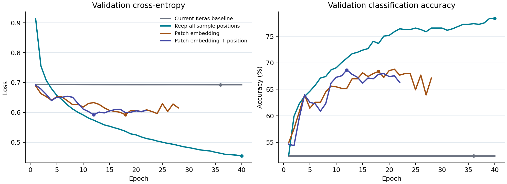
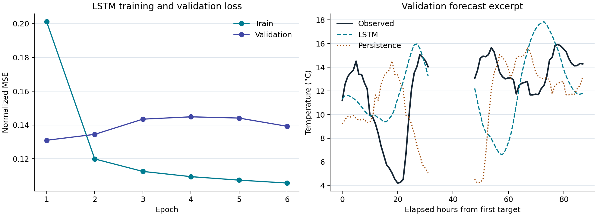

# CMPE 401 Project 2 · Time-series modelling benchmark

This project reproduces two Keras examples. The FordA Transformer assigns a class to an entire engine-sensor trace. The Jena Climate LSTM forecasts a continuous temperature from past weather observations. Three FordA modifications test how the model uses sample order, local patterns, and patch position.

## Results

### FordA classification

All four rows use the same 40-epoch cap and the same held-out test split. The validation loss selects the checkpoint.

| Configuration | Parameters in full graph | Best epoch / epochs run | Validation loss | Test accuracy | Balanced test accuracy |
| --- | ---: | ---: | ---: | ---: | ---: |
| [Current Keras baseline](results/baseline/metrics.json) | 29,258 | 36 / 40 | 0.6924 | 51.59% | 50.00% |
| [Keep sample positions](results/samplewise/metrics.json) | 93,130 | 40 / 40 | 0.4543 | 80.00% | 79.99% |
| [Patch embedding](results/patch/metrics.json) | 278,194 | 18 / 28 | 0.5923 | 67.05% | 67.28% |
| [Patch embedding + position](results/patch-position/metrics.json) | 278,514 | 12 / 22 | 0.5920 | 67.73% | 68.10% |

The full current graph reached 51.59% after one training epoch. With a 150-epoch cap, the folded current graph stopped after 61 epochs and also scored 51.59%, the majority-class rate. The same cap with sample-wise pooling reached 83.71% test accuracy and 0.3616 test loss. The published 93,130-parameter run reports 84.32% test accuracy and 0.3544 test loss. [Direct one-epoch run](results/forda-literal/metrics.json) · [Extended current run](results/baseline-150/metrics.json) · [Extended sample-wise run](results/samplewise-150/metrics.json) · [Published Keras run](https://keras.io/examples/timeseries/timeseries_classification_transformer/)

### Jena Climate forecasting

The 5,153-parameter LSTM trained on 299,979 windows from 420,551 source rows. Epoch 1 had the lowest normalized validation MSE. Early stopping ended training after 6 epochs as training loss continued falling and validation loss stayed above its first-epoch value. The source tutorial reports a best validation MSE of 0.1267 under its own run. [Run metrics](results/climate/metrics.json) · [Published Keras run](https://keras.io/examples/timeseries/timeseries_weather_forecasting/)

| Method | Normalized MSE | MAE (°C) | RMSE (°C) |
| --- | ---: | ---: | ---: |
| LSTM | 0.1310 | 2.44 | 3.13 |
| Last-value persistence | 0.4302 | 4.39 | 5.66 |

Metrics use the same 118,352 validation windows for both methods. The LSTM reduced RMSE by 44.8% relative to persistence.

## FordA · Transformer classification

**Data and protocol.** The [FordA archive](https://www.timeseriesclassification.com/description.php?Dataset=FordA) contains 500 univariate engine-noise readings per case from an automotive diagnostic problem. The supplied split has 3,601 training and 1,320 test traces. A seeded permutation of the training file reserves 721 traces for validation and uses 2,880 for training. The original labels `-1` and `1` map to `0` and `1`. Inputs have shape `(batch, 500, 1)`. The two softmax outputs give the class probabilities.

**Baseline.** Four Transformer blocks use four self-attention heads of dimension 256, a pointwise feed-forward network with inner width 4, residual connections, layer normalization, and dropout (0.25). Global average pooling feeds a 128-unit ReLU layer, dropout (0.4), and the softmax. Training uses sparse categorical cross-entropy, Adam at 0.0001, and batches of 64. The 40-epoch benchmark uses seed 401, identical splits and training settings, and checkpoint selection by lowest validation loss, with patience 10. Accuracy measures the fraction of correct test labels. Balanced accuracy averages the per-class recalls. The majority-class reference always predicts the most frequent training label.

**Reproduction discrepancy.** The current [Keras example](https://keras.io/examples/timeseries/timeseries_classification_transformer/) specifies `channels_last` pooling, which averages the 500-position sequence into one value. Its published model summary instead shows 500 pooled values and 93,130 parameters, consistent with `channels_first` pooling on the same input shape. The historical output reports 84.32% test accuracy. The separate 150-epoch-cap runs compare these two readings of the example.

**Why the difference matters.** Both branches in every unpatched block use layer normalization across a single output channel. For any scalar \(x\), the channel mean is \(x\) and the variance is zero, so the normalized term is zero and the layer returns its trainable offset \(\beta\). In exact arithmetic, each block therefore passes the input through with two learned scalar offsets. Averaging the residual over time reduces the trace to a near-constant mean because the traces are already centered. Keeping all 500 positions lets the dense head learn from the waveform. The 40-epoch comparisons and extended runs fold the unpatched branches to the equivalent scalar shifts for CPU training, then transfer the learned offsets and dense weights back into the full graph. The run records include measured probability differences on a fixed 16-trace test probe. Floating-point rounding and random dropout streams can differ between engines. A separate literal run trains the current Keras architecture directly for one full-data epoch.

### Three modifications

| Experiment | Change and hypothesis | Comparison |
| --- | --- | --- |
| `samplewise` | Use the pooling axis implied by the published model summary. Passing each sample position to the classifier should preserve waveform information. | Current baseline |
| `patch` | Add a learned convolutional embedding with a kernel and stride of 25, giving 20 tokens with 16 channels each. This lets attention operate across patches and layer normalization retain variation across channels. | Current baseline |
| `patch-position` | Add a learned 16-dimensional position vector to each patch. Position vectors should help when the location or order of patterns carries class information. | Patch embedding |

The two patch variants retain the current example’s temporal pooling, four blocks, and other training hyperparameters. The patch-only model preserves ordering within each 25-point patch through the convolution kernel. Its encoder and mean pooling are invariant to permutations of whole patches. Position embeddings allow the classifier to distinguish such permutations. The verification script checks this with a patch reversal on eight held-out traces.



## Jena Climate · LSTM forecasting

**Data and protocol.** The [Keras weather example](https://keras.io/examples/timeseries/timeseries_weather_forecasting/) uses measurements from the Max Planck Institute weather station in Jena. This reproduction selects pressure, temperature, saturation vapor pressure, vapor pressure deficit, specific humidity, air density, and wind speed. It uses the first 71.5% of rows to compute per-feature means and standard deviations. Sliding windows advance one source row at a time, and each window samples every sixth row, giving 120 nominally hourly observations and input shape `(batch, 120, 7)`. The target is one future standardized temperature per window.

**Baseline and evaluation.** A 32-unit LSTM processes the history in time order. Its gates control what information enters, persists in, and leaves the recurrent state. A linear dense unit maps the last hidden state to one temperature. The model uses Adam at 0.001, normalized MSE, a batch size of 256, and up to 10 epochs with early-stopping patience 5. Evaluation reloads the checkpoint with the lowest validation loss. It reports normalized MSE and converts errors back to °C for MAE and RMSE. Persistence forecasts the last observed input temperature on the same validation windows.

**Window alignment.** For a window starting at row `s`, the inputs are `s, s+6, ..., s+714` and the target is `s+792`. That is 78 rows, or nominally 13 hours, after the last input. The 12-hour description in the source uses the boundary at `s+720`. The training code keeps the source row order and uses row offsets throughout. The timestamps contain a few gaps and reversals, so elapsed time can deviate from the nominal horizon. The forecast figure uses the recorded timestamps and breaks the lines at gaps. The original indexing also allows the last 78 training targets to cross the nominal split. The first scored validation target starts 792 rows after the split, so the scored target indices are disjoint from training targets. Validation input windows can include those first 78 post-split temperatures. The example reserves this validation period for checkpoint selection, and this reproduction reports validation scores only. A chronological test period and windows confined to each split would be needed to estimate performance on unseen future data.



## Reflection

**Which model was easier to understand, and why?** The LSTM was easier to trace. Each time step updates one recurrent state, and a single dense unit maps the final state to temperature. The Transformer required following both the attention tensor and the normalization and pooling axes. The FordA example showed why inspecting intermediate shapes matters as much as reading the layer names.

**What improvements were tried, and what did they show?** Retaining the 500 sample positions improved test accuracy by 28.41 percentage points at the common budget. Patch embedding brought accuracy to 67.05% while reducing attention from 500 to 20 tokens per trace. Zero-initialized position vectors preserved the initial predictions of the patch-only model and increased test accuracy by 0.68 percentage points. Validation loss was 0.5920 with position vectors and 0.5923 without them. The reversal check confirms that the position-aware model responds to patch order. The sample-wise configuration had the best validation loss and test accuracy at the shared budget. With one split and seed, the small positional gain should be treated as an observation for this run.

## Reproduce and verify

Use Python 3.12. The recorded runs used TensorFlow 2.20.0 and Keras 3.12.0 on Apple Silicon CPU. The scripts download the official data files on first use and log SHA-256 hashes. Runs write to `runs/` by default and can be regenerated without changing the shipped `results/`.

```bash
python3.12 -m venv .venv
source .venv/bin/activate
python -m pip install -r requirements.txt

# Check the delivered predictions, checkpoints, and window alignment.
python -m benchmark.verify

# Train both baselines and all three FordA variants.
python -m benchmark.climate
python -m benchmark.forda --engine folded --epochs 40 --output runs/baseline
python -m benchmark.forda --config samplewise --engine folded --epochs 40 --output runs/samplewise
python -m benchmark.forda --config patch --epochs 40 --output runs/patch
python -m benchmark.forda --config patch-position --epochs 40 --output runs/patch-position
python -m benchmark.figures --source runs --output runs/figures

# Match the historical 150-epoch cap for both pooling settings.
python -m benchmark.forda --engine folded --output runs/baseline-150
python -m benchmark.forda --config samplewise --engine folded --output runs/samplewise-150

# Train the current published architecture directly for one full-data epoch.
# Omit --epochs 1 to use its original 150-epoch cap with early stopping.
python -m benchmark.forda --epochs 1 --output runs/forda-literal
```

`benchmark/forda.py` and `benchmark/climate.py` contain the experiment code. `results/<run>/` contains the epoch log, metrics, predictions, and checkpoint. Import `benchmark.forda` before loading a FordA checkpoint to register its custom position layer. The Jena checkpoint loads into `benchmark.climate.build_model()`. The [figure script](benchmark/figures.py) regenerates both plots from the logged outputs.

## Sources and contributions

- FordA baseline adapted from Theodoros Ntakouris’s [Keras Transformer example](https://keras.io/examples/timeseries/timeseries_classification_transformer/). The [FordA dataset archive](https://www.timeseriesclassification.com/description.php?Dataset=FordA) describes the classification task.
- Jena baseline adapted from Prabhanshu Attri, Yashika Sharma, Kristi Takach, and Falak Shah’s [Keras weather example](https://keras.io/examples/timeseries/timeseries_weather_forecasting/). The [Max Planck Institute for Biogeochemistry](https://www.bgc-jena.mpg.de/wetter/) records the weather observations.
- Project additions include the experiment runners, FordA variants, evaluation controls, and verification code. Codex assisted with implementation, experiment execution, and documentation. Keras examples carry the [Apache 2.0 license](LICENSE).
